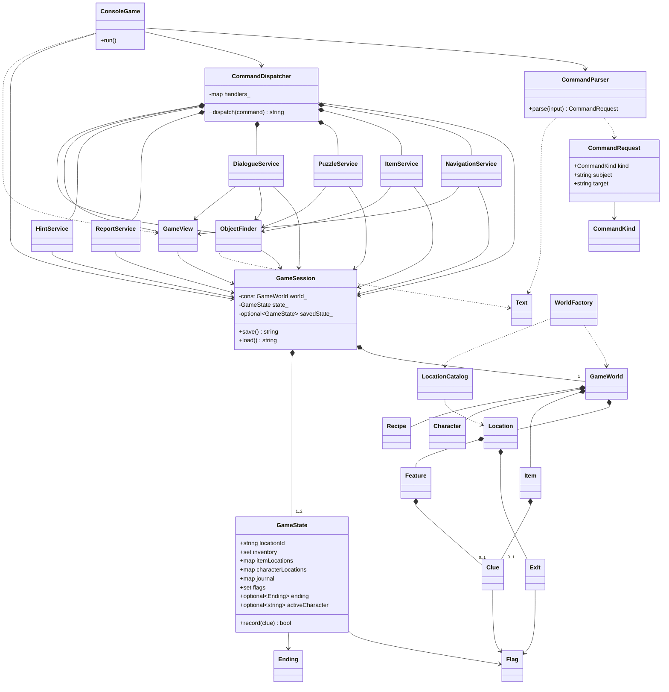

# Objektový návrh

Definice světa je oddělená od stavu konkrétní rozehrané hry. Služby vracejí textové výsledky, ale nečtou konzoli ani do ní nezapisují. Stejné příkazy proto lze spouštět v konzoli i v automatických průchodech.

## Zpracování příkazu

`ConsoleGame` načte řádek přes `std::getline`. `CommandParser` normalizuje česká písmena, mezery a diakritiku a vytvoří `CommandRequest`. Ten obsahuje druh akce, předmět a případný cíl. Parser neprovádí herní akce a jeho hlavička nezávisí na modelu světa.

`CommandDispatcher` vybere podle `CommandKind` funkci z registru strategií. Používá `std::map<CommandKind, std::function<std::string(const CommandRequest&)>>`. Každá strategie zavolá příslušnou službu. Registr nahrazuje dlouhý řetězec podmínek nad původním textovým vstupem. Jde o vzor Strategy vyjádřený standardními funkčními objekty; pro každou jednoduchou akci není potřeba zvláštní implementační třída.

Služba ověří podmínky, případně změní `GameState` a vrátí text. Výsledek vypíše `ConsoleGame`. `GameView` skládá popis místnosti, inventáře a deníku bez přímého vstupu či výstupu.

## Odpovědnosti tříd

| Třída | Odpovědnost a implementace |
| --- | --- |
| `ConsoleGame` | Úvod, řádky a hlavní smyčka; `src/console.cpp` |
| `CommandParser`, `Text` | Syntaktická analýza a normalizace; `src/parser.cpp`, `src/text.cpp` |
| `CommandRequest`, `CommandKind` | Strukturovaný požadavek; `include/vila/commands.hpp` |
| `CommandDispatcher` | Výběr strategie a zákaz akcí po konci; `src/dispatcher.cpp` |
| `WorldFactory`, `LocationCatalog` | Sestavení pevného světa; `src/world.cpp`, `src/locations.cpp` |
| `GameWorld` | Katalogy lokací, předmětů, postav a receptů; `include/vila/model.hpp` |
| `Location`, `Exit` | Vrcholy a hrany grafu, podmínka průchodnosti |
| `Item`, `Feature`, `Character`, `Recipe`, `Clue` | Přenosné věci, pevné objekty, postavy, kombinace a indicie |
| `GameState`, `Flag`, `Ending` | Veškerý měnitelný stav; `include/vila/model.hpp`, `src/model.cpp` |
| `GameSession` | Svět, aktuální hra a jediný uložený stav; `src/session.cpp` |
| `ObjectFinder` | Hledání dostupných věcí a postav; `src/finder.cpp` |
| `NavigationService` | Pohyb a kontrola zámků; `src/navigation.cpp` |
| `ItemService` | Sbírání, prohlídka, kombinace a zápisy indicií; `src/items.cpp` |
| `PuzzleService` | Pravidla pracovny, generátoru, krytu a trezoru; `src/puzzles.cpp` |
| `DialogueService` | Podmíněné odpovědi, klíč, svědectví a záchrana; `src/dialogue.cpp` |
| `ReportService` | Místo odevzdání a výsledek; `src/report.cpp` |
| `HintService` | Nejbližší užitečný krok; `src/hints.cpp` |
| `GameView` | Aktuální popisy světa a kolekcí; `src/view.cpp` |

Datové struktury s veřejnými poli používají `struct`. Služby a objekty s vlastním řízením stavu používají `class`. Návrh využívá skládání objektů; pro žádnou ze současných odpovědností není potřeba dědičnost.

## Diagram tříd

Grafická verze je v [diagramy.html](diagramy.html). Následující zdroj zachycuje i vztahy jednotlivých služeb a datových struktur.

## Graf a herní objekty

`GameWorld::locations` je `std::map` identifikátorů a každá lokace má `std::vector` východů. `Exit::destination` odkazuje na identifikátor sousední místnosti. Východ lze pojmenovat směrem nebo podporovaným názvem cíle.

Hrany do pracovny a krytu zůstávají v grafu i při uzamčení. Jejich průchodnost závisí na příznaku `StudyUnlocked` nebo `ShelterOpened`. Zpáteční cesta je vždy dostupná. Testy ověřují existenci cílů, spojitost a návratnost grafu; úplné průchody ověřují i skutečnou dosažitelnost při respektování zámků.

Inventář je `std::set<std::string>` identifikátorů věcí. Deník je samostatná `std::map<std::string, std::string>` identifikátorů a textů indicií; stejnou indicii nelze přidat dvakrát. `Item` může mít vazbu na indicii, ale přečtením text nevzniká v inventáři.

Zvednutí odstraní věc z `itemLocations` a přidá ji do inventáře. Kombinace spotřebuje oba vstupy a přidá výsledek. Oprava generátoru spotřebuje sadu, zatímco klíč a páčidlo zůstávají. Záchrana přesune majitelku i hráče na verandu.

## Vlastnictví a životnost

`GameSession` vlastní `const GameWorld`, aktuální stav a volitelný uložený stav. Svět se po sestavení nemění. Vyhledávač proto může vracet nevlastnící ukazatele na předměty a objekty v jeho kontejnerech. Spotřebování věci mění pouze inventář, nikoli definici, na kterou ukazatel míří.

Dispatcher vlastní služby. Služby si předávají reference na relaci, vyhledávač a pohled, které žijí déle než volání akcí. Funkce strategií zachycují `this`, proto má dispatcher zakázané kopírování; nemůže vzniknout kopie funkcí navázaná na původní objekt. Uvnitř `DialogueService` žijí funkce voleb pouze po dobu zpracování rozhovoru.

Kód nepoužívá vlastní `new`, `delete`, sdílené vlastnictví ani ruční uvolňování paměti. O prostředky se starají standardní kontejnery a hodnotové členy objektů.

## Uložení v paměti

`GameState` obsahuje polohu hráče, inventář, polohy věcí a postav, deník, příznaky, výsledek a aktivní rozhovor. Všechna tato data mají hodnotovou sémantiku. Přiřazení `savedState_ = state_` vytvoří nezávislé kopie řetězců i kontejnerů. Načtení `state_ = *savedState_` opět kopíruje; pozdější akce proto uložený stav nezmění.

Tento snapshot odpovídá principu Memento bez serializace a dalšího správce. Projekt spoléhá na výchozí kopírování C++ a nepíše vlastní kopírovací konstruktor ani destruktor. To je zde použití pravidla nuly. Definice světa se nesnímkuje, protože je konstantní.

Služby získávají stav přes `GameSession::state()` při každé akci. Obnoví se i aktivní dialog. Pohyb, prohlídka a jiné změnové akce jej ukončí, aby dříve zobrazená čísla odpovědí nemohla po změně podmínek znamenat něco jiného.

## Hádanky a konce

1. Zápisník zpřístupní žádost o klíč v rozhovoru se správcem. Klíč otevře pracovnu. Datum z portrétu určuje kód trezoru a zpřístupní servisní protokol.
2. Baterie ze spíže a drát z dílny vytvoří sadu pro generátor.
3. Napájený zámek a páčidlo dovolí otevřít kryt. Dialog s majitelkou nabízí doprovod do bezpečí.

Číselný kód je informace, nikoli předmět. Správný kód lze i uhodnout. Fyzické předměty musí hráč vlastnit a cílový objekt musí být v aktuální místnosti.

| Stav při odevzdání | Výsledek |
| --- | --- |
| Zachráněná majitelka a nalezený servisní protokol | Úplné vyšetření |
| Zachráněná majitelka bez protokolu | Záchrana |
| Známá příčina bez záchrany | Příčina zjištěna, záchrana nedokončena |
| Zbylé případy | Nevyřešeno |

Záchrana zaznamená svědectví majitelky a příčinu. Důkazy a záchranu lze získat v libovolném pořadí. Hra nemá časový limit ani náhodu, takže opakované zkoušení příkazů neblokuje řešení.

## Rozsah návrhu

Definice světa je přímo v C++. Externí datový formát by přidal parser a chybové stavy bez přínosu pro toto zadání. Konzolová vrstva přijímá standardní `std::istream` a `std::ostream`, což stačí pro skutečnou konzoli i testovací řetězcové proudy. Služby se propojují konstruktory; projekt nepotřebuje kontejner závislostí ani vlastní framework.

Přidání předmětu znamená doplnit katalog. Nová místnost vyžaduje definici a východy. Nový příkaz se doplní do `CommandKind`, parseru a registru strategií. Nová hádanka dostane pravidlo v `PuzzleService`, případné příznaky a test průchodu.
